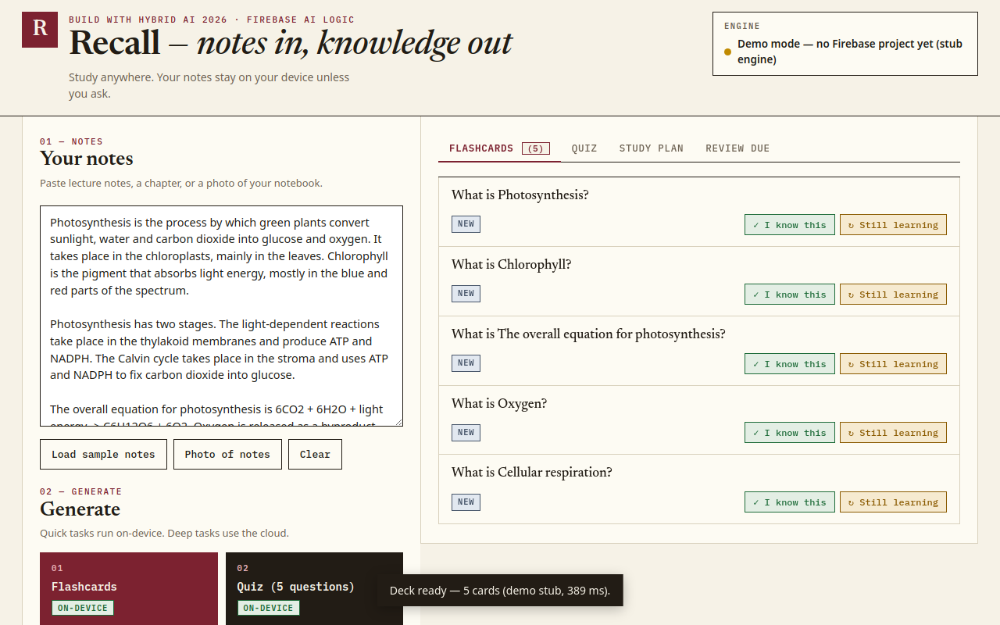
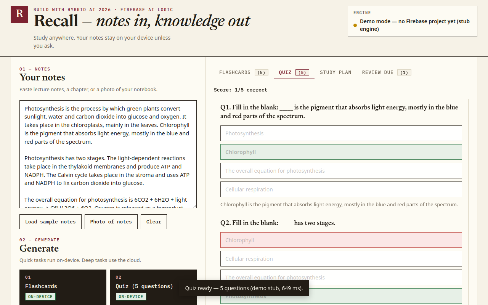
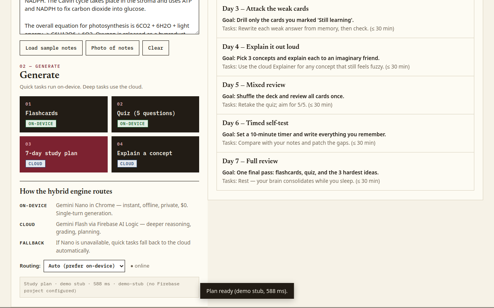
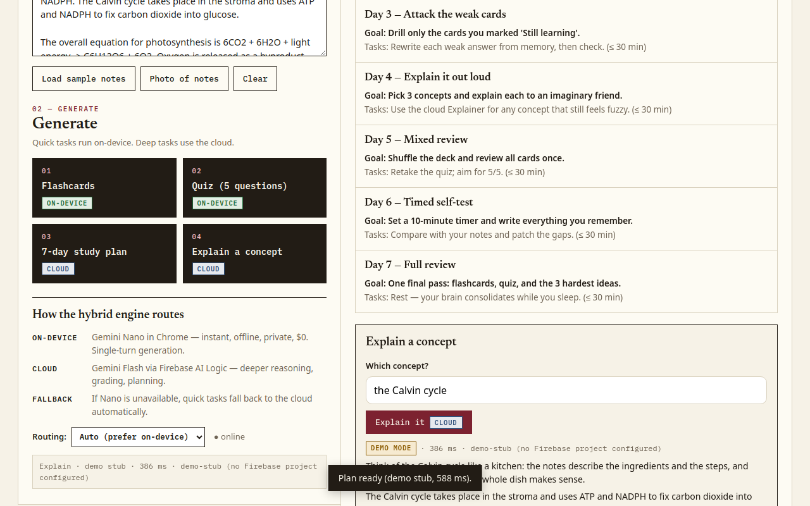

# Recall — Offline-first AI study companion

**Built for #BuildHybridAI 2026** (Google × Firebase). Web app, Best Web/Chrome category.

Turn your notes into flashcards, quizzes and a 7-day study plan. The quick
tasks run **on-device with Gemini Nano** (instant, offline, private, $0);
the deep tasks — grading free-text answers, explaining concepts, planning —
run **in the cloud with Gemini Flash**. Both go through **Firebase AI Logic
hybrid inference**, so the same code path serves every user whether or not
their device has Nano.

## Why this is a real hybrid app (not a demo of one API)

| Task | Engine | Why that route |
|---|---|---|
| Flashcards (JSON) | `PREFER_ON_DEVICE` → Gemini Nano, cloud fallback | Single-turn generation, instant, works offline in a library or on a plane. Notes never leave the device. |
| Quiz (JSON) | `PREFER_ON_DEVICE` → Gemini Nano, cloud fallback | Same — fast, private, free. |
| Grade free-text answer | `ONLY_IN_CLOUD` → Gemini Flash | Needs deeper reasoning and a rubric; worth the round-trip. |
| Explain a concept | `ONLY_IN_CLOUD` → Gemini Flash | Multi-sentence reasoning + analogy. |
| 7-day study plan | `ONLY_IN_CLOUD` → Gemini Flash | Needs the notes + your quiz results together. |

Every AI answer shows a **route badge** (on-device / cloud / demo), latency
and model name, so the hybrid behaviour is visible, not claimed. A routing
switch (Auto / On-device only / Cloud only) lets judges force each path.

## Tech

- **Firebase AI Logic** (`firebase/ai` v12.5.0+): `getAI` with
  `GoogleAIBackend`, `getGenerativeModel` with `InferenceMode.PREFER_ON_DEVICE`
  / `ONLY_ON_DEVICE` / `ONLY_IN_CLOUD`, `initializeDeviceModel()` on user
  gesture, structured JSON output (`responseSchema`) for flashcards, quiz
  and grading, multimodal input (photo of handwritten notes, JPEG/PNG).
- **Firebase App Check** enforced (as the AI Logic setup requires); debug
  provider for localhost — see `src/config.js`.
- **No build step.** Vanilla JS + ES modules, Firebase SDK via CDN import map.
- **Offline-first storage:** decks, quiz results and the spaced-repetition
  review queue (SM-2-lite) live in `localStorage`. Firestore sync is a
  documented follow-up, not a dependency.
- **Demo mode:** with no Firebase project configured, a deterministic local
  stub engine implements the exact same interface, so the whole flow is
  testable offline with zero keys. The UI always labels demo answers.

## Run it

```bash
# Any static server works. From this folder:
python3 -m http.server 8080
# open http://localhost:8080
```

On-device Nano needs **Chrome 139+ on Desktop** with the flag
`chrome://flags/#prompt-api-for-gemini-nano-multimodal-input` enabled.
Without it (or without a Firebase project) the app still works: quick tasks
fall back to the cloud, and without keys it runs in demo mode.

### Wire up Firebase (5 minutes, free tier)

1. Create a project at https://console.firebase.google.com
2. Console → AI Services → AI Logic → Get started → choose the
   **Gemini Developer API** provider (free tier, no billing).
3. Register this web app, paste the config into `src/config.js`
   (replace the `YOUR_*` placeholders).
4. For localhost: keep `appCheckDebug: true`, copy the debug token from the
   browser console and register it under Firebase console → App Check →
   Manage debug tokens. **Never commit real keys** — inject them at deploy
   time (e.g. Firebase App Hosting env config).
5. Optional: request extra quota via the hackathon's Quota Form sprints
   (Sprint 2: request by Nov 18 10:00 PT; Sprint 3: by Nov 25 10:00 PT).

## Try it in 60 seconds

1. Click **Load sample notes** (photosynthesis lecture notes).
2. Click **Flashcards** — a deck appears; click a card to flip it, mark
   “I know this” / “Still learning”.
3. Click **Quiz** — answer 5 questions, then grade a free-text answer.
4. Click **7-day study plan** — a plan built from your notes + quiz result.
5. Click **Explain a concept** — ask e.g. “the Calvin cycle”.
6. Check the **Review due** tab — cards you marked “Still learning” return
   on a spaced schedule.

## Screenshots






## Testing

Headless end-to-end test (Playwright + Chromium, demo mode — no keys):

```bash
node test.mjs
```

It runs the full flow — sample notes → flashcards (incl. keyboard flip) →
quiz → free-text grading → 7-day plan → explain → review queue → routing
switch → reload persistence — and fails on any console error, page error or
failed request. Last run (2026-11-17): **23/23 checks passed, 0 console
errors, 0 failed requests**. The test also refreshes the screenshots above.

## Accessibility

- Full keyboard support: tabs follow the WAI-ARIA pattern (arrow keys,
  Home/End, roving tabindex), flashcards flip with Enter/Space, the photo
  picker is a real focusable file input, every control has a visible
  `:focus-visible` outline.
- All form fields have labels; async results (grading, explanations) use
  `aria-live="polite"`; the toast uses `role="alert"`.
- Text contrast is ≥ 4.5:1 throughout, including the route badges and the
  engine-status record box in the masthead. No decorative emoji are used.

## Built during the submission period

Recall was built from scratch for #BuildHybridAI 2026 (Nov 11–30, 2026):
the hybrid engine (`src/ai/engine.js` — Firebase AI Logic with
`PREFER_ON_DEVICE` / `ONLY_IN_CLOUD` / `ONLY_ON_DEVICE`, JSON
`responseSchema`, multimodal image input, App Check), the full study flow
(notes → flashcards → quiz → cloud grading → 7-day plan → spaced review),
the demo-mode stub engine that makes the whole flow testable offline, the
headless test suite, and the demo video. No pre-existing code was reused.

## Project structure

```
index.html            App shell + Firebase import map
styles.css            Design system ("the card catalogue": Newsreader +
                      IBM Plex Mono, paper/ink/oxblood, hairline rules)
fonts/                Self-hosted woff2 (Newsreader, IBM Plex Mono) — the
                      site makes zero external font requests
src/
  config.js           Firebase config (placeholders) + App Check settings
  app.js              UI controller
  store.js            localStorage store + SM-2-lite review queue
  demo-data.js        Sample lecture notes
  ai/
    engine.js         HybridEngine: real Firebase AI Logic + demo stub
    prompts.js        Prompt builders + JSON schemas (shared by both engines)
test.mjs              Headless end-to-end test (Playwright): full flow,
                      keyboard + tab navigation, 0-error gate; refreshes
                      screenshots/*.png — run with `node test.mjs`
screenshots/          01-flashcards · 02-quiz · 03-plan · 04-explain
firebase.json         Firebase App Hosting config
DEMO_SCRIPT.md        2-3 minute demo video script
SUBMISSION.md         Submission checklist (what is done / still missing)
```

## License

Apache License 2.0 — see `LICENSE`.
